# WING Native Footswitch

Osobní odposlech na pultu **Behringer WING** ovládaný z telefonu a nohou. Muzikant si v aplikaci **WING Monitor** pro Android sám řídí svůj in-ear nebo wedge mix (Aux) a přes Bluetooth **footswitch** se třemi klapkami ho ovládá i při hraní, bez rukou.

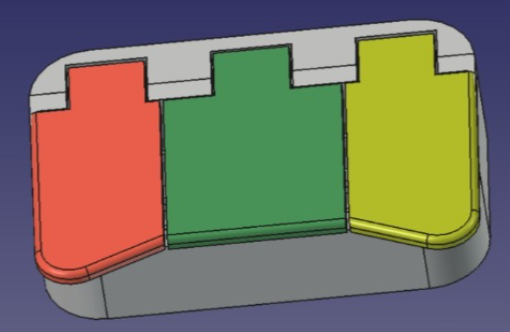

> Projekt nesouvisí se společnostmi Behringer ani Music Tribe. WING je ochranná známka svého vlastníka.

## K čemu to je

Na pódiu si každý muzikant chce sám doladit, kolik slyší sebe, zpěv nebo bicí. Oficiální aplikace jsou ale plné malých faderů a během hraní na ně nejsou volné ruce. Tenhle projekt to řeší takhle:

- **Aplikace WING Monitor** ukazuje jen to podstatné: skupiny nástrojů a velká tlačítka **TIŠE / HLASITĚJI / ZTLUMIT**. Mění **jen Aux mix hráče**, nikdy gain ani hlavní mix.
- **Footswitch** (ESP32 + 3 mikrospínače + 5 LED) posílá stisky klapek do telefonu přes Bluetooth LE: levá a pravá = tišeji / hlasitěji nebo pohyb v seznamu, prostřední = otevřít, zpět, ztlumit.
- **Automatika** podle živých úrovní vstupů z pultu: ztlumení šumu ze sálu a ochrana uší při přebuzení.

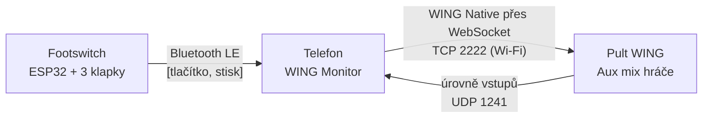

Aplikace mluví s pultem stejným protokolem jako oficiální WING-Q: **WING Native** (binární protokol) zabalený do WebSocketu na TCP 2222. Popis protokolu: [WING Remote Protocols 3.1 (PDF)](https://cdn-media.empowertribe.com/2106004e217b8eb2639d93672823eef5/WING_Remote-Protocols-3.1-03.pdf).

## Obsah repozitáře

| Složka | Obsah |
|---|---|
| [`android/`](android/) | aplikace WING Monitor (Java, Gradle), balíček `cz.svatjir.wingmonitor` |
| [`firmware/WingPedal/`](firmware/) | program pro ESP32 (Arduino, NimBLE, FastLED) |
| [`firmware/wokwi/`](firmware/wokwi/) | zapojení pro simulátor [Wokwi](https://wokwi.com) |
| [`hardware/footswitch.FCStd`](hardware/footswitch.FCStd) | model krabičky ve FreeCADu |
| [`hardware/3mf/`](hardware/3mf/) | díly k 3D tisku |
| [`tools/pc-simulator/`](tools/pc-simulator/) | PC simulátor pedálu a simulátor vstupů (přehrává CC0 hudbu) |
| [`tools/wing-mock/`](tools/wing-mock/) | simulátor pultu WING pro testy bez pultu |
| [`tests/e2e/`](tests/e2e/) | automatické end-to-end testy v Android emulátoru |
| [`docs/images/`](docs/images/) | obrázky, schéma, snímky obrazovky |

## Snímky obrazovky

<table>
  <tr>
    <td align="center">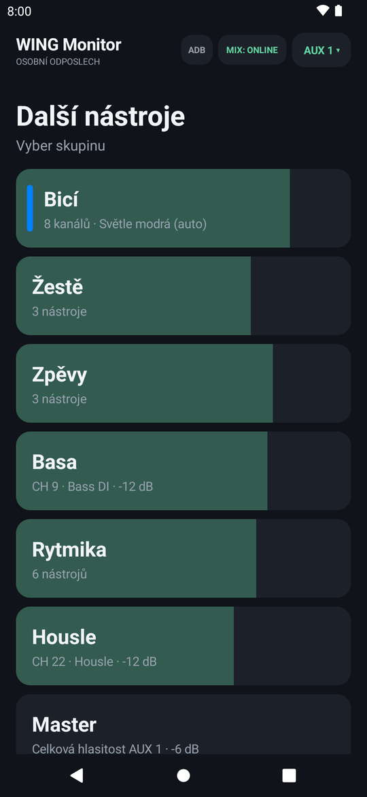<br>Skupiny nástrojů</td>
    <td align="center">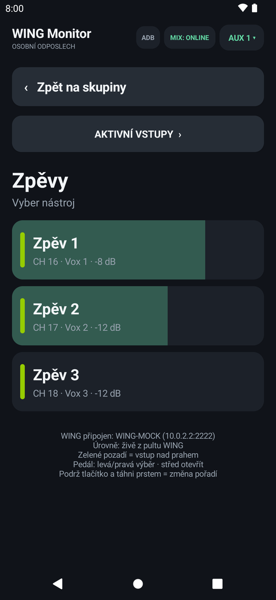<br>Nástroje ve skupině</td>
    <td align="center">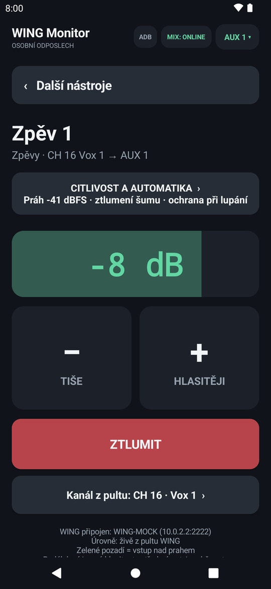<br>Hlasitost nástroje</td>
    <td align="center">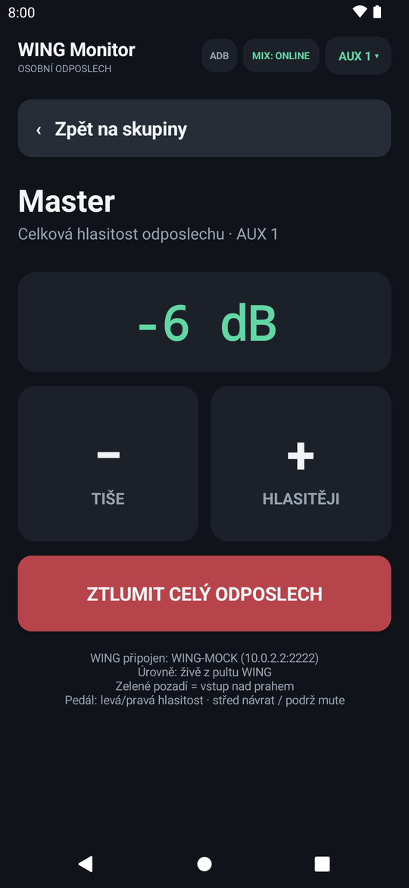<br>Celý odposlech (Master)</td>
  </tr>
  <tr>
    <td align="center">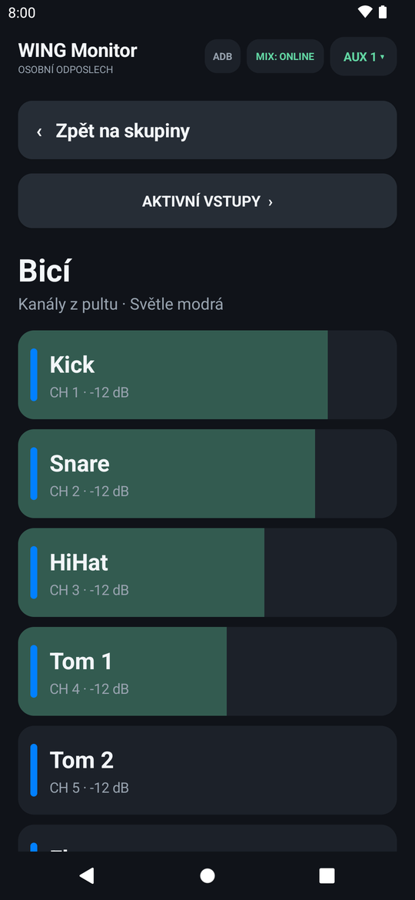<br>Bicí – kanály podle barvy</td>
    <td align="center">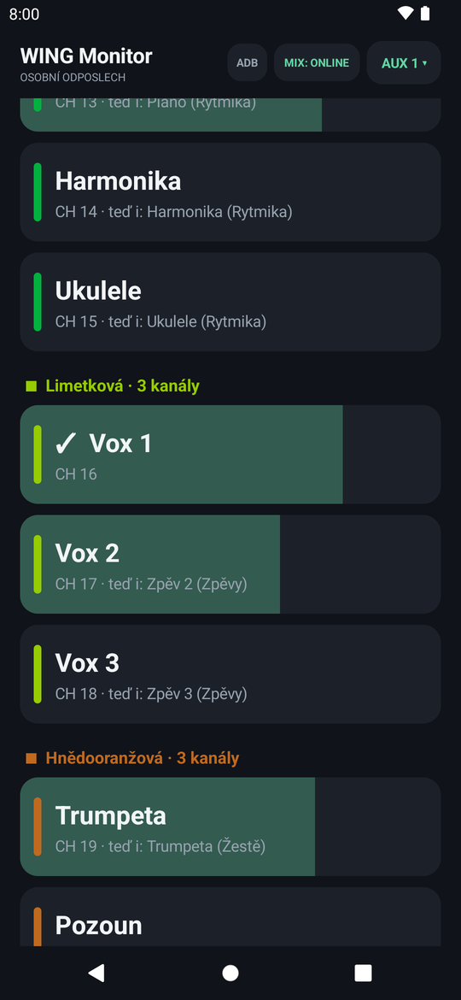<br>Přiřazení kanálu z pultu</td>
    <td align="center">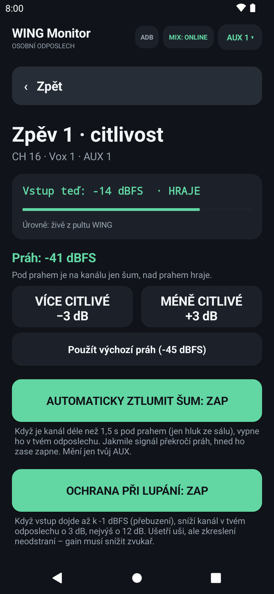<br>Citlivost a automatika</td>
    <td align="center">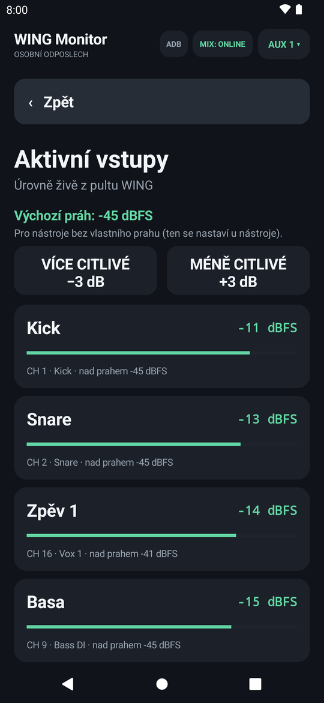<br>Aktivní vstupy</td>
  </tr>
</table>

Snímky jsou z Android emulátoru připojeného k simulátoru pultu (`tools/wing-mock`) s ukázkovou kapelou. Zelené pozadí ukazuje vstupy, které právě hrají.

## Používání

### První spuštění

1. Telefon připojte do stejné Wi-Fi sítě jako pult. Aplikace pult najde sama. Když ho nenajde, klepněte na štítek **MIX** a zadejte IP adresu pultu.
2. Vyberte **svůj odposlech** (Aux). Později ho změníte štítkem **AUX ▾**.
3. Vyberte **skupinu** a svůj **hlavní nástroj**. Příště se aplikace otevře rovnou na jeho stránce hlasitosti.
4. Na stránce nástroje přiřaďte **Kanál z pultu**. Výběr ukazuje kanály s názvy a barvami přímo z pultu.

Štítky nahoře:

| Štítek | Význam |
|---|---|
| **MIX: ONLINE / OFFLINE / HLEDÁM** | spojení s pultem; bez spojení se změny ukládají jen v telefonu |
| **BLE: VYP / ČEKÁ / OK** | Bluetooth přijímač pro footswitch: vypnutý / čeká na pedál / pedál připojen |
| **AUX 1 ▾** | váš odposlech |

### Skupiny a nástroje

- **Bicí** se naplní samy, a to všemi pojmenovanými kanály v barvě bicích.
- **Žestě, Zpěvy, Basa, Rytmika, Housle**: každý nástroj se přiřadí k jednomu kanálu pultu.
- **Master**: celková hlasitost vašeho odposlechu.
- Pořadí skupin, nástrojů i kanálů bicích změníte tak, že tlačítko podržíte a přetáhnete prstem.

### Ovládání nohou

| Klapka | Krátký stisk | Podržení |
|---|---|---|
| **levá** | předchozí položka / o 1 dB tišeji | opakuje |
| **prostřední** | otevřít / vrátit se | přes 0,65 s: ztlumit (stránka nástroje, Master), zpět (seznam) |
| **pravá** | další položka / o 1 dB hlasitěji | opakuje |

Pět LED nad klapkami ukazuje stav pedálu: **modrý had** zleva doprava, dokud pedál hledá telefon, a **slabě zelená** po připojení. Sešlápnutá klapka krátce blikne **červeně** svou LED (levá 1., prostřední 3., pravá 5.), podržení prostřední klapky blikne LED 2–4.

### Citlivost a automatika

Na stránce nástroje v **Citlivost a automatika** nastavíte:

- **práh**: pod ním je na kanálu jen šum, nad ním nástroj hraje,
- **automaticky ztlumit šum**: kanál, který je 1,5 s pod prahem (třeba hluk ze sálu), se ve vašem Auxu vypne a s prvním tónem zase zapne,
- **ochranu při lupání**: při přebuzení (−1 dBFS) se kanál ve vašem Auxu ztiší o 3 dB, celkem nejvýš o 12 dB.

Podrobnosti jsou v [android/README.md](android/README.md#úrovně-vstupů-citlivost-a-automatika).

## Seznam součástek

| Ks | Součástka | Poznámka |
|---|---|---|
| 1 | **ESP32 NodeMCU** / ESP32-DevKitC (ESP-WROOM-32) | v Arduino IDE „ESP32 Dev Module“ |
| 1 | **Step-down modul 4 A XL4015**, DC-DC, CC/CV | nastavit na 5,0 V |
| 1 | **WS2812B** pásek, 5 LED | 5 V, adresovatelný („NeoPixel“) |
| 3 | **Mikrospínač MS-1A-L14.5-P** (prodává se i jako MS-1A-14,5P) | páčka s kladkou, SPDT, typ KW11 |
| 1 | rezistor 330 Ω | do datového vodiče pásku |
| 1 | elektrolytický kondenzátor 470 µF / ≥ 10 V | na napájení pásku |
| 1 | napájecí adaptér 9–12 V DC, ≥ 1 A, a konektor | celý pedál bere zhruba do 0,3 A |
| 3+3 | *volitelně* rezistor 10 kΩ a kondenzátor 100 nF | odrušení vstupů při delších vodičích |
| | vodiče, smršťovací bužírky | |

Díly k tisku (`hardware/3mf/`), všechny vyexportované z modelu `hardware/footswitch.FCStd`:

| Soubor | Díl |
|---|---|
| `body.3mf` | hlavní těleso pedálu (200 × 120 × 50 mm) |
| `esp32-v1.3mf` | držák desky ESP32 |
| `kw11-v1.3mf` | vložka pro mikrospínač (pro každý spínač jedna) |
| `stepdown-v01.3mf` | držák měniče XL4015 |

Model ve FreeCADu obsahuje i tři klapky (levou, prostřední a pravou), horní kryt a vanu.

## Schéma zapojení

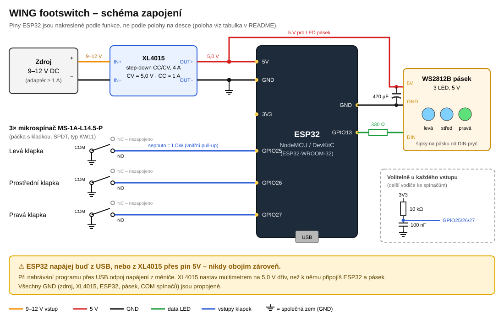

| Spoj | Odkud | Kam |
|---|---|---|
| napájení | adaptér 9–12 V | XL4015 **IN+ / IN−** |
| 5 V | XL4015 **OUT+** (5,0 V) | ESP32 **5V** a pásek **5V** |
| zem | XL4015 **OUT−** | ESP32 **GND**, pásek **GND**, **COM** všech spínačů |
| data LED | ESP32 **GPIO 13** → 330 Ω | pásek **DIN** |
| levá klapka | spínač **NO** | ESP32 **GPIO 25** |
| prostřední klapka | spínač **NO** | ESP32 **GPIO 33** |
| pravá klapka | spínač **NO** | ESP32 **GPIO 32** |
| | spínač **NC** | nezapojeno |

Na desce ESP32-DevKitC (38 pinů, USB dole) jsou všechny potřebné piny na **levé straně**. Odshora: 3V3, EN, VP, VN, 34, 35, **32**, **33**, **25**, 26, 27, 14, 12, **GND**, **13**, D2, D3, CMD, **5V**. Jiné varianty desek (například 30pinová DevKit V1) mají jiné pořadí, proto se vždy řiďte popisky natištěnými na desce. Oficiální rozložení pinů je v [dokumentaci Espressifu](https://docs.espressif.com/projects/esp-dev-kits/en/latest/esp32/esp32-devkitc/user_guide.html).

Vstupy používají vnitřní pull-up rezistory ESP32: rozepnutý spínač = HIGH, sešlápnutá klapka spojí pin s GND = LOW.

> [!WARNING]
> **ESP32 napájejte buď z USB, nebo z XL4015 přes pin 5V, nikdy obojím zároveň.** Při nahrávání programu přes USB odpojte napájení z měniče.

**Nastavení XL4015 (před připojením ESP32):**

1. Připojte jen adaptér na **IN+ / IN−**, výstup nechte volný.
2. Multimetrem měřte **OUT+ / OUT−** a trimrem **CV** nastavte **5,0 V**.
3. Proudové omezení **CC** můžete nastavit asi na 1 A, pedál bere zhruba do 0,3 A.
4. Teprve pak připojte ESP32 a pásek.

**LED pásek:** připojte se na začátek pásku (DIN), šipky na pásku musí mířit od místa připojení pryč. První LED je nad levou klapkou, třetí nad prostřední a pátá nad pravou; pokud je pásek otočený, nastavte ve firmwaru `LED_REVERSED = true`.

## Firmware

Program pro ESP32 je ve [`firmware/WingPedal/WingPedal.ino`](firmware/WingPedal/WingPedal.ino). Potřebuje jádro ESP32 Arduino 3.x a knihovny NimBLE-Arduino 2.x a FastLED 3.x.

```powershell
arduino-cli compile --fqbn esp32:esp32:esp32 firmware/WingPedal
arduino-cli upload --fqbn esp32:esp32:esp32 -p COM5 firmware/WingPedal
```

Bez hardwaru jde pedál vyzkoušet v simulátoru Wokwi (bez Bluetooth, telefon nahrazuje tlačítko):

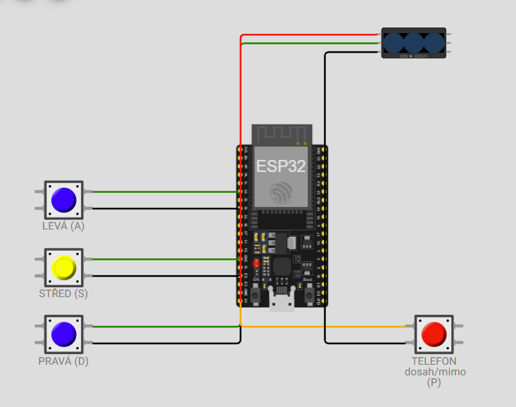

Podrobnosti, stavy LED a postup pro Wokwi jsou ve [firmware/README.md](firmware/README.md).

## Párování pedálu s telefonem

Pedál se zatím **nepáruje v nastavení Bluetooth** systému Android. Připojuje se přímo k aplikaci: aplikace vysílá službu pedálu (UUID `8d53dc1d-1db7-4cd3-868b-8a527460aa84`) a pedál se připojí k **nejbližšímu** telefonu, který ji vysílá.

### Postup

1. **V telefonu** otevřete WING Monitor a klepněte na štítek **BLE: VYP**.
2. Povolte oprávnění **Zařízení v okolí** a případně zapnutí Bluetooth. Štítek se změní na **BLE: ČEKÁ**: aplikace teď na pedál čeká.
3. **Zapněte pedál** blízko telefonu (do 1–2 m). LED ukazují **modrého hada** zleva doprava, protože pedál hledá telefon.
4. Pedál 3 s sbírá telefony v dosahu a připojí se k tomu s nejsilnějším signálem. Signál musí být aspoň **−80 dBm**, slabší telefony pedál ignoruje.
5. Po připojení svítí všechny LED **slabě zeleně** a aplikace ukazuje **BLE: OK**.
6. Sešlápněte klapku. Její LED krátce blikne **červeně** a aplikace zareaguje.

### Dobré vědět

- **Po každém spuštění aplikace** je potřeba BLE znovu zapnout klepnutím na **BLE: VYP**.
- Když se spojení přeruší (telefon mimo dosah, aplikace zavřená), pedál začne sám znovu hledat (modrý had) a po návratu telefonu se připojí.
- **Pedál v nastavení Bluetooth telefonu nepárujte.** Zařízení „WING Pedal“ se tam párovat nemá, spojení řídí aplikace.
- **Víc muzikantů s aplikací na jednom pódiu:** pedál zapínejte vedle svého telefonu, aby měl jasně nejsilnější signál.
- **Modrý had běží dlouho:** zkontrolujte, že aplikace ukazuje **BLE: ČEKÁ**, a přibližte telefon. Sériová linka ESP32 (115200 Bd) vypisuje nalezené telefony i se silou signálu (`Phone with WING Monitor: … RSSI -84`).

### Bezpečnost a plán

Spojení zatím není šifrované ani vázané na jeden telefon. Pedál se připojí k jakémukoli blízkému telefonu s aplikací. Před ostrým nasazením je v plánu **skutečné spárování (bonding)**: podržením prostřední klapky při zapnutí by se pedál přepnul do párovacího režimu, Android by zobrazil dialog **Spárovat** a pedál by si telefon zapamatoval a dál se připojoval jen k němu. **Zatím to není implementováno.**

## Vývoj bez pultu a bez pedálu

- **Simulátor pultu** ([`tools/wing-mock`](tools/wing-mock/)) chová se pro aplikaci i pro WING-Q jako WING s ukázkovou kapelou, včetně živých úrovní vstupů.
- **PC simulátor pedálu** ([`tools/pc-simulator`](tools/pc-simulator/)) ovládá aplikaci v emulátoru přes ADB nebo skutečný telefon přes Bluetooth LE stejně jako ESP32.
- **Simulátor vstupů** přehrává CC0 skladbu a posílá úrovně jednotlivých stop do simulátoru pultu; umí i šum sálu a „lupnutí“.
- **End-to-end testy** ([`tests/e2e`](tests/e2e/)) spustí aplikaci v emulátoru proti simulátoru pultu a ověří pedál, ztlumení šumu, ochranu proti přebuzení i přejmenování kanálu.

```powershell
# aplikace
android\gradlew.bat -p android :app:assembleDebug

# simulátor pultu + simulátory pedálu a vstupů
py -3.13 tools\wing-mock\mock_wing.py --bind 127.0.0.1
tools\pc-simulator\run.bat

# testy (simulátor pultu / emulátor)
py -3.13 -m unittest discover -s tools\wing-mock -v
py -3.13 -m unittest discover -s tests\e2e -v
```

## Stav projektu

- Aplikace je otestovaná proti simulátoru pultu a s aplikací WING-Q v emulátoru. **Se skutečným pultem WING zatím ověřená není.** Formát měření vstupů je převzatý z WING-Q.
- Footswitch je ověřený na skutečné desce ESP32 s telefonem: spojení přes BLE i všechny tři vstupy fungovaly s původním pinoutem GPIO 25/26/27. Nový pinout GPIO 25/33/32 zatím na desce ověřený není. LED pásek a spínače v hotové krabičce se zatím testují.
- Párování (bonding) pedálu s jedním telefonem zatím chybí, viz výše.

## Licence

Kód, firmware, model a dokumentace jsou pod licencí [MIT](LICENSE).

Ukázkové nahrávky v `tools/pc-simulator/audio` mají vlastní licenci **CC0**. Zdroje jsou uvedené v README u nahrávek.
