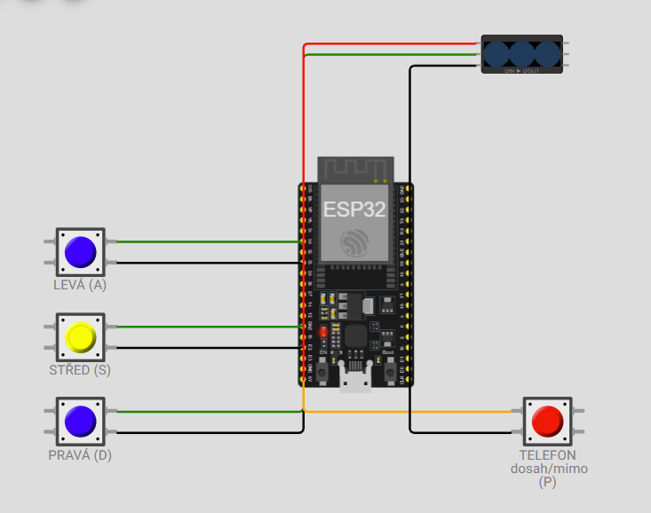

# WingPedal – firmware pro ESP32

Arduino program pro skutečný třítlačítkový footswitch. ESP32 se přes Bluetooth LE připojí k telefonu s aplikací WING Monitor a při každém stisku a puštění klapky pošle dva bajty `[tlačítko, stisknuto]`. Je to stejný protokol, jaký používá PC simulátor pedálu (`tools/pc-simulator/pedal_simulator.py`).

## Hardware

- ESP32 NodeMCU / DevKitC (ESP32-WROOM-32), v Arduino IDE deska **ESP32 Dev Module**.
- Napájení z měniče **XL4015** nastaveného na **5,0 V** do pinu **5V** desky.
- 3 × mikrospínač **MS-1A-L14.5-P** (páčka s kladkou, SPDT, typ KW11): **COM → GND**, **NO → GPIO**, NC nezapojený.
- Adresovatelný pásek **WS2812B** se 3 LED (5 V). Obyčejný 12V RGB pásek bez čipu v každé LED by potřeboval MOSFETy a jiný program.

| Funkce | Pin ESP32 |
|---|---|
| Levá klapka (NO spínače) | GPIO 25 |
| Prostřední klapka | GPIO 26 |
| Pravá klapka | GPIO 27 |
| DIN pásku (přes ~330 Ω) | GPIO 13 |
| 5 V a GND pásku | 5 V z XL4015 / společná GND |

Piny 25, 26 a 27 mají zapnutý vnitřní pull-up (`INPUT_PULLUP`): rozepnutý spínač = HIGH, sepnutý (spojený s GND) = LOW. U delších vodičů ke spínačům přidejte u ESP32 ke každému vstupu 10 kΩ na 3V3 a 100 nF na GND.

Mezi 5 V a GND hned u pásku patří kondenzátor 470 µF. Datový signál 3,3 V krátký pásek WS2812B obvykle zvládne. Pokud LED blikají nebo ukazují nesmysly, přidejte převodník úrovní 74AHCT125. První LED u DIN patří levé klapce. Pokud je pásek v krabičce otočený, nastavte `LED_REVERSED = true`.

> **Pozor na napájení:** ESP32 napájejte **buď z USB, nebo z XL4015 do pinu 5V, nikdy obojím zároveň**. Při nahrávání programu přes USB odpojte napájení z měniče, případně celý měnič.

Celé schéma zapojení je v hlavním [README](../README.md#schéma-zapojení).

## LED

| Stav | LED |
|---|---|
| Start (≈1,5 s) | všechny zelené |
| Hledá telefon / připojuje se | jedna modrá LED běží dokola |
| Připojeno | všechny světle modré |
| Klapka sešlápnutá | LED té klapky zelená (i bez telefonu, hodí se pro kontrolu zapojení) |

Barvy, jas (`LED_BRIGHTNESS`, výchozí 90/255) a piny jsou konstanty na začátku `WingPedal.ino`.

## Překlad a nahrání

Potřebné je jádro **ESP32 Arduino 3.x** a knihovny **NimBLE-Arduino 2.x** a **FastLED 3.x**. Ověřeno s jádrem 3.3.3, NimBLE 2.5.0 a FastLED 3.10.3.

1. Arduino IDE → otevřít `WingPedal/WingPedal.ino`.
2. Deska **ESP32 Dev Module**, vybrat COM port, **Nahrát**.
3. Volitelně Serial Monitor na 115200 Bd: vypisuje nalezené telefony, připojení a každý stisk a puštění klapky.

Z příkazové řádky (ve složce `firmware`):

```powershell
arduino-cli lib install "NimBLE-Arduino" "FastLED"
arduino-cli compile --fqbn esp32:esp32:esp32 WingPedal
arduino-cli upload --fqbn esp32:esp32:esp32 -p COM5 WingPedal
```

## Vyzkoušení ve Wokwi (bez hardwaru)

[Wokwi](https://wokwi.com) simuluje ESP32, tlačítka i pásek WS2812B, ale **ne Bluetooth**. Program proto má simulační režim (`WING_PEDAL_SIMULATION 1`): Bluetooth se vynechá, čtvrté červené tlačítko **TELEFON** (GPIO 14) přepíná „telefon v dosahu / mimo dosah“ a každý zápis, který by šel do telefonu, se vypíše na sériovou linku (např. `[SIM] BLE write 03 01` = pravá klapka dolů). Wokwi simuluje i zákmity spínačů, takže se ověří i jejich ošetření.



V prohlížeči:

1. Otevřete <https://wokwi.com/projects/new/esp32>.
2. Vložte obsah `WingPedal/WingPedal.ino` do `sketch.ino` a změňte `#define WING_PEDAL_SIMULATION 0` na `1`.
3. Na záložce `diagram.json` nahraďte obsah souborem `wokwi/diagram.json`.
4. Přidejte knihovnu **FastLED** (Library Manager nebo soubor `libraries.txt` jako `wokwi/libraries.txt`).
5. Spusťte simulaci. Klikejte na tlačítka nebo použijte klávesnici: **A** / **S** / **D** = levá / prostřední / pravá klapka, **P** = telefon. Ctrl+klik tlačítko podrží (například pro vyzkoušení podržení prostřední klapky).

Očekávané chování: 1,5 s zelená, 3 s běžící modrá, pak světle modrá. Držená klapka rozsvítí svou LED zeleně a vypíše zápis. **P** spojení přeruší (běžící modrá) a druhé **P** se po 3 s znovu připojí.

Ve **Wokwi for VS Code** otevřete složku `wokwi`. `wokwi.toml` používá předpřeložený simulační firmware ve `wokwi/build`, který vytvoříte takto:

```powershell
arduino-cli compile --fqbn esp32:esp32:esp32 --build-property "compiler.cpp.extra_flags=-DWING_PEDAL_SIMULATION=1" --output-dir wokwi\build WingPedal
```

## Omezení

- **Zatím bez párování (bondingu).** Pedál se připojí k *nejbližšímu* telefonu, který inzeruje službu pedálu WING Monitor a má signál aspoň −80 dBm (`MIN_RSSI`). Postup je v hlavním README v části [Párování pedálu s telefonem](../README.md#párování-pedálu-s-telefonem).
- Ověřeno na skutečné desce ESP32-DevKitC (CP2102): pedál najde telefon, připojí se (aplikace ukáže **BLE: OK**) a vstupy GPIO 25/26/27 fungují v aplikaci jako levá, prostřední a pravá klapka. LED pásek a finální spínače v krabičce zatím ověřené nejsou.
